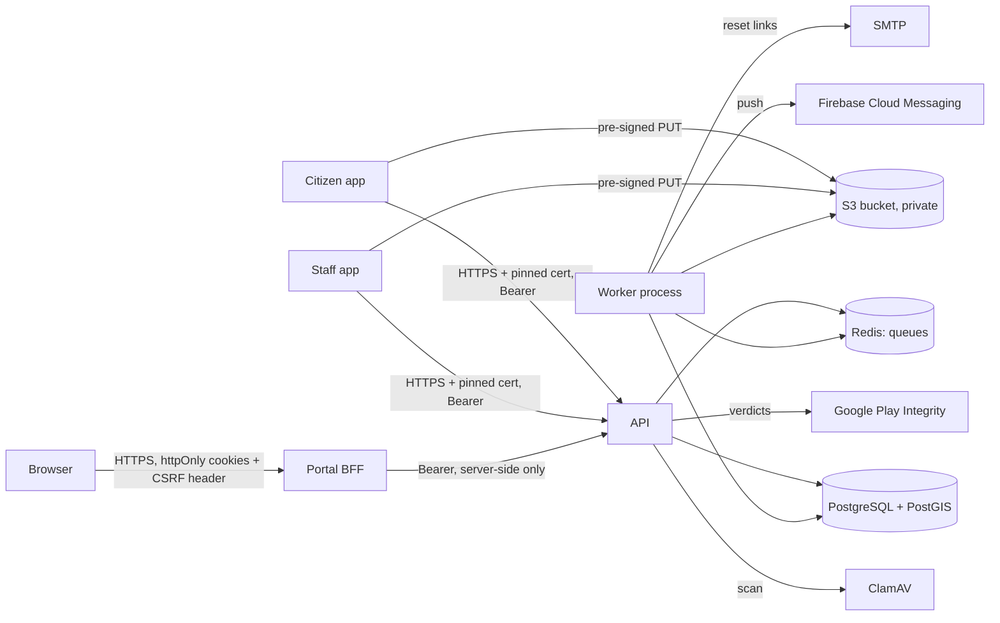

# Audit pack (for the CERT-In-empanelled auditor and the external pentest)

## Scope
| Component | What | How to reach (staging) |
|---|---|---|
| API | NestJS REST API `/api/v1`, used by both apps and the portal | `https://<api-host>/api/v1` (OpenAPI at `/api/docs` is disabled in production; provided on staging) |
| Portal | Next.js admin/supervisor portal with server-side session layer (BFF) | `https://<portal-host>` |
| Citizen app | Android, package `org.citywaste.cwm_citizen` | APK from CI (`android` job artifact) or Play internal track |
| Staff app | Android, package `org.citywaste.cwm_staff` | as above |
| Storage | S3-compatible bucket (private, signed URLs) | via the API only |
Out of scope unless agreed: hosting provider infrastructure, Google Play / Firebase / hCaptcha services.

## Test accounts (create on staging, one per role)
Web Admin, District Admin, two Sub Admins of different ULBs (for horizontal-escalation tests),
supervisor of area A, supervisor of area B, two workers, two citizens. Admin roles need an
authenticator app (TOTP). For app testing with Play Integrity, run staging with
`PLAY_INTEGRITY_MODE=monitor` so a test device/emulator is not blocked; production uses `enforce`.

## Architecture and data flows

Personal data: citizens' name, optional father/husband name, mobile, email (mobile/email/TOTP
secrets AES-256-GCM encrypted in the DB, keys outside the DB), complaint photos (metadata stripped),
GPS points, free-text descriptions/remarks. Staff: name, mobile, email.

## Roles and permissions (summary)
| | Web Admin | District Admin | Sub Admin | Supervisor | Worker | Citizen |
|---|---|---|---|---|---|---|
| Complaints visible | all | own district | own ULB | own area / routed to them | assigned to them | own |
| Assign / reject / merge | — | — | ✓ | ✓ (own area) | — | — |
| Start / resolve with photo | — | — | ✓ | ✓ | ✓ (own tasks) | — |
| Masters (wards, areas, types) | types, districts, ULBs | ULBs of district | wards, areas | — | — | — |
| Staff | District Admins | Sub Admins | supervisors, workers | — | — | — |
| Event zones | view | own district | own ULB | view own | — | — |
| Reports / exports | ✓ | ✓ | ✓ | own area | — | — |
| MFA required | ✓ | ✓ | ✓ | — | — | — |
Enforced in API guards **and** in every query (`common/complaint-scope.ts`), tested per endpoint.

## Threat model (STRIDE, highlights)
| Threat | Main controls | Evidence |
|---|---|---|
| Spoofed evidence (old/gallery/edited photos, fake GPS) | per-install Keystore key signs each capture; server checks signature, hash, age, mock flag, accuracy; Play Integrity on the key | `test/security/media`, `test/security/attestation`, contract test |
| Account takeover | Argon2id, lockout, MFA for admins, rotating refresh tokens with reuse detection, sessions revoked on reset | `test/security/authentication`, `mfa-recovery` |
| IDOR / horizontal escalation | scope predicate in every query; UUIDs; 404 not 403 outside scope | `test/security/authorization`, Playwright cross-ULB tests |
| Data exposure | PII encrypted at rest, minimal fields to staff, EXIF stripped, 5-min signed URLs, exports without citizen identity | `media.e2e`, `reports` |
| Tampering with history | append-only triggers on events, audit log, feedback (remark erasure only) | `audit-integrity`, `privacy.e2e` |
| DoS / abuse | rate limits, size caps, daily complaint cap, queue for video, load-tested to 2× peak | `rate-limiting`, `infra/load/RESULTS.md` |
| Rooted phones / repackaged apps | Play Integrity verdict + certificate digest; root heuristics in Staff app; R8 | `play-integrity.spec`, `attestation.e2e` |
| Privacy (DPDP) | consent per notice version, export, correction, erasure, retention jobs | `privacy.e2e`, citizen widget tests |

## Evidence the vendor provides
- Control → test mapping: [`docs/SECURITY.md`](../SECURITY.md) (with known gaps).
- Automated tests: API (unit + e2e incl. `test/security/*`), portal unit + Playwright, Dart unit,
  widget and contract tests. CI: `.github/workflows/ci.yml`.
- DAST: OWASP ZAP report from the vendor's own run (see [`DAST.md`](DAST.md)).
- Load / soak: [`infra/load/RESULTS.md`](../../infra/load/RESULTS.md).
- Backup/restore drill: `infra/ops/restore-drill.sh` output.
- Dependency audit: `npm run audit:prod` (API, portal), Trivy image scan in CI.

## Known gaps to look at first
See "Known gaps" in [`docs/SECURITY.md`](../SECURITY.md): no iOS attestation, PII key rotation
job, portal `style-src 'unsafe-inline'`, per-process refresh single-flight, root detection is
heuristic, push uses deprecated FCM token API, privacy notice text awaits legal review.
